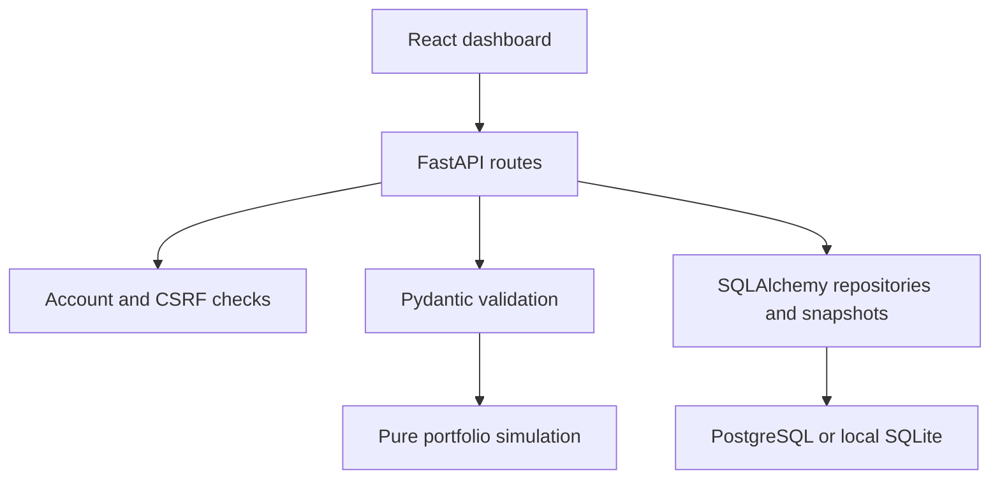

# Architecture and code responsibilities

`backend/app/main.py` coordinates authorized workflows, idempotency, exports and static dashboard serving. `security.py` hashes passwords with Argon2, stores session-token hashes, checks CSRF and limits login attempts. `schemas.py` validates financial contracts and matching observation calendars. `engine.py` computes metrics without database or HTTP dependencies. `imports.py` previews CSV rows without saving them. `models.py` defines ownership and frozen analysis data. `database.py` supplies request-scoped transactions; migrations own schema changes.

`frontend/src/main.jsx` implements portfolio creation, assumption input, import review, saved analysis and comparisons. `api.js` owns requests and in-memory CSRF tokens. `components/AuthScreen.jsx` manages registration/login forms. `styles.css` provides responsive and print layouts.

Data: User → Portfolio → Analysis; User → LoginSession. Analyses store inputs, source, adjustment method, observations, results, engine version and creation timestamp together. Subsequent edits never update existing snapshots. Every portfolio and analysis read checks ownership. UUID secrecy is not authorization.

For a larger product, split route/service/repository and dashboard components by workflow. The calculation engine is already independent so this refactoring does not change financial methods.
